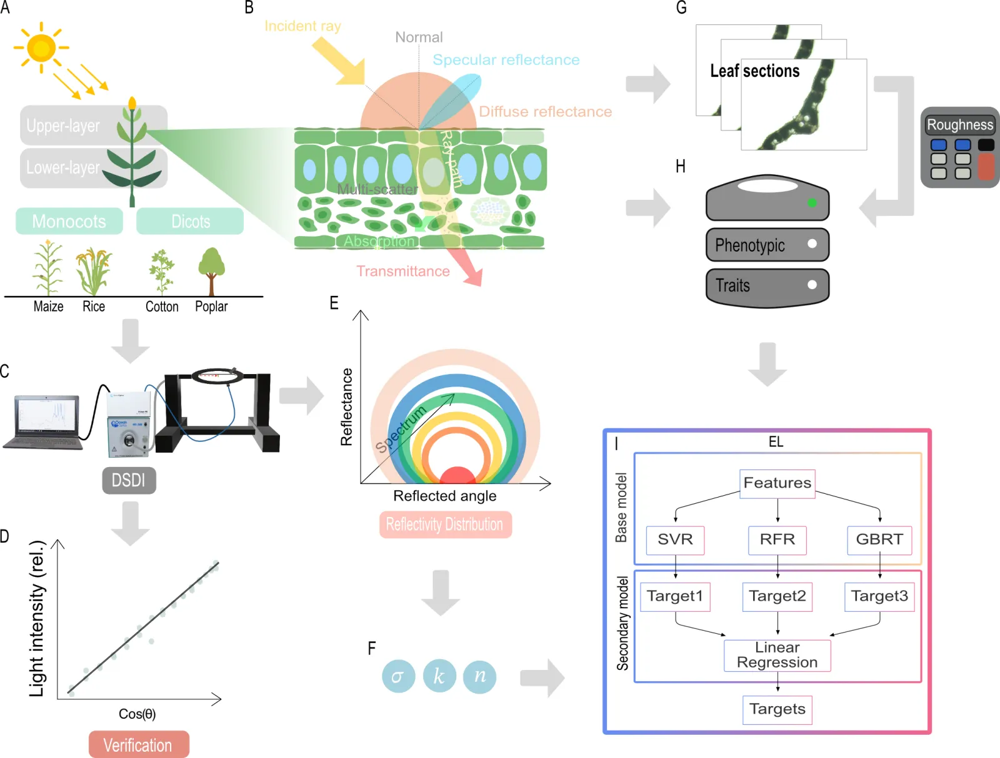

import AltmetricBadge from '@site/src/components/AltmetricBadge';

Our study on predicting leaf BRDF from phenotypic traits is published in *Plant Phenomics* (2025). Leaf directional reflectance can be predicted from traits that are easy to measure, and the resulting differences in leaf optics change how light is distributed inside a simulated canopy. The framework combines a custom-built Directional Spectrum Detection Instrument (DSDI), Cook–Torrance BRDF fitting, ensemble learning and canopy ray tracing.

<!-- truncate -->

<AltmetricBadge doi="10.1016/j.plaphe.2025.100135" badgeType="donut" className="brdfAltmetric" />

## At a glance

- **Plant material:** maize, rice, cotton, and poplar leaves from upper and lower canopy positions.
- **Directional spectra:** 400–1000 nm, measured across a broad angular range with the DSDI.
- **BRDF parameters:** roughness $\sigma(\lambda)$, diffuse reflection coefficient $k(\lambda)$, and refractive index $n(\lambda)$.
- **Predictive model:** a stacking ensemble built from support vector, random forest, and gradient boosting regressors.
- **Performance:** BRDF fitting $R^2 > 0.95$; ensemble prediction $R^2 = 0.83$–$0.99$, depending on the parameter.

## Read more

- **[Project page](/research/brdf-traits)**: the full problem, method, results and limitations, with an interactive explorer showing how roughness, diffuse reflection and refractive index shape the reflectance pattern.
- [BRDF fitting scripts and Roughness Calculator](https://github.com/PlantSystemsBiology/brdf)
- [fastTracer canopy ray-tracing software](https://github.com/PlantSystemsBiology/fastTracerPublic)

## Citation

Deng, L., Yu, L. X., Mao, L., Wang, Y., Guo, X., Wang, M., Zhang, Y., Song, Q., & Zhu, X.-G. (2025). **Leaf bidirectional reflectance distribution function (BRDF) prediction with phenotypic traits in four species: Development of a novel measuring and analyzing framework.** *Plant Phenomics, 7*(4), 100135. [https://doi.org/10.1016/j.plaphe.2025.100135](https://doi.org/10.1016/j.plaphe.2025.100135)
