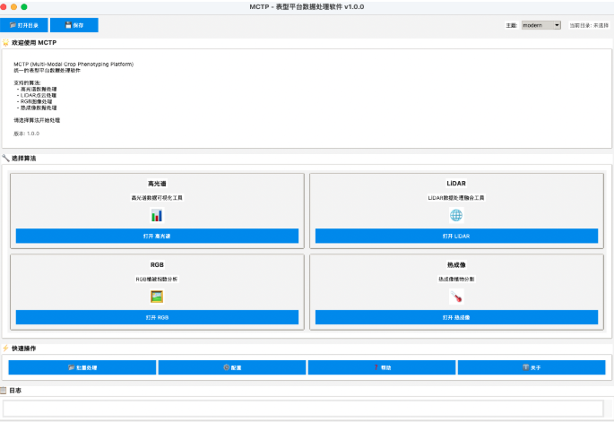

**MCTP (Multi-modal Crop Trait Processing)** is a desktop platform that processes hyperspectral, LiDAR, RGB and thermal phenotyping data with one interface, interactive parameter tuning, batch processing and structured JSON/CSV exports. It was developed for the field walking phenotyping platform of Shufeng Bio; I was responsible for system optimization and for the data-processing and analysis methods.

<!-- truncate -->

## What it covers

- **Hyperspectral:** NDVI plant masks, glare removal and leaf-region mean spectra, processed in batch.
- **LiDAR:** RANSAC ground rebasing, DBSCAN plant segmentation and canopy traits: coverage, voxel occupancy, convex-hull volume and height percentiles H10/H50/H90.
- **RGB:** vegetation segmentation from three colour indices and labelling of individual plants.
- **Thermal:** temperature thresholds suggested from Otsu's method and percentiles, with overlay and heatmap previews.

## Read more

The **[project page](/research/mctp-workspace)** describes each module with screenshots, the recommended workflow and the roadmap. To try MCTP or obtain sample data, see the contact details on the [CV page](/cv).
