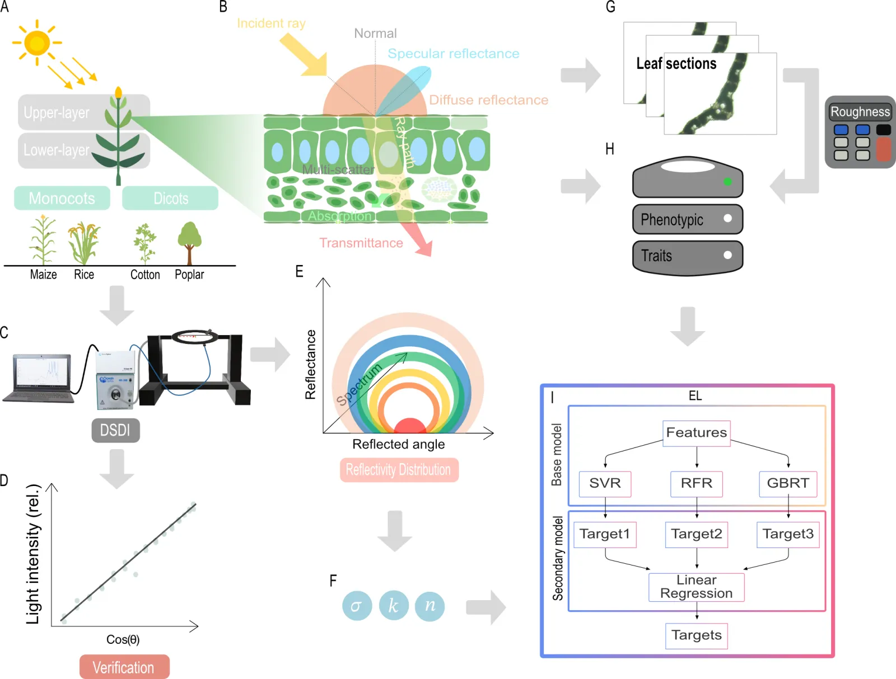

import AltmetricBadge from '@site/src/components/AltmetricBadge';

我们关于由表型性状预测叶片 BRDF 的研究已发表于 *Plant Phenomics*（2025）。叶片的方向反射可以由易测的表型性状预测，叶片光学特性的差异会改变模拟冠层内的光分布。这套框架结合了自主研制的方向光谱检测仪（DSDI）、Cook–Torrance BRDF 模型拟合、集成学习和冠层光线追踪。

<!-- truncate -->

<AltmetricBadge doi="10.1016/j.plaphe.2025.100135" badgeType="donut" className="brdfAltmetric" />

## 要点

- **材料：** 玉米、水稻、棉花和杨树叶片，分别取自冠层上部和下部。
- **方向光谱：** 用 DSDI 在大角度范围内测量 400–1000 nm 光谱。
- **BRDF 参数：** 粗糙度 $\sigma(\lambda)$、漫反射系数 $k(\lambda)$ 和折射率 $n(\lambda)$。
- **预测模型：** 由支持向量回归、随机森林和梯度提升回归构成的堆叠集成模型。
- **性能：** BRDF 拟合 $R^2 > 0.95$；集成模型预测 $R^2 = 0.83$–$0.99$（因参数而异）。

## 延伸阅读

- **[项目页](/research/brdf-traits)**：完整的问题、方法、结果与局限，并附交互演示，可查看粗糙度、漫反射系数和折射率如何改变反射分布。
- [BRDF 拟合脚本与粗糙度计算器](https://github.com/PlantSystemsBiology/brdf)
- [fastTracer 冠层光线追踪软件](https://github.com/PlantSystemsBiology/fastTracerPublic)

## 引用

Deng, L., Yu, L. X., Mao, L., Wang, Y., Guo, X., Wang, M., Zhang, Y., Song, Q., & Zhu, X.-G. (2025). **Leaf bidirectional reflectance distribution function (BRDF) prediction with phenotypic traits in four species: Development of a novel measuring and analyzing framework.** *Plant Phenomics, 7*(4), 100135. [https://doi.org/10.1016/j.plaphe.2025.100135](https://doi.org/10.1016/j.plaphe.2025.100135)
