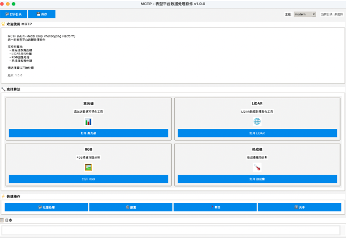

**MCTP（Multi-modal Crop Trait Processing，多模态作物性状处理平台）** 是一个桌面平台，以统一界面、交互式调参、批量处理和结构化的 JSON/CSV 导出，处理高光谱、LiDAR、RGB 和热红外表型数据。平台为黍峰生物的田间步行式表型平台开发，我负责系统优化以及数据处理与分析方法。

<!-- truncate -->

## 覆盖内容

- **高光谱：** NDVI 植株掩膜、去除反光、叶片区域平均光谱，支持批量处理。
- **LiDAR：** RANSAC 重定地面、DBSCAN 分割植株，计算覆盖度、体素占有率、凸包体积和高度分位数 H10/H50/H90 等冠层性状。
- **RGB：** 基于三种颜色指数分割植被，并标记单株。
- **热红外：** 基于 Otsu 方法和分位数给出建议温度阈值，提供叠加图和热图预览。

## 延伸阅读

**[项目页](/research/mctp-workspace)** 介绍了每个模块（附截图）、推荐流程和后续计划。如需试用 MCTP 或获取示例数据，请见[个人简历页](/cv)中的联系方式。
